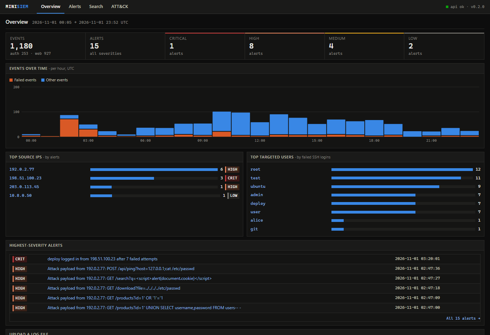
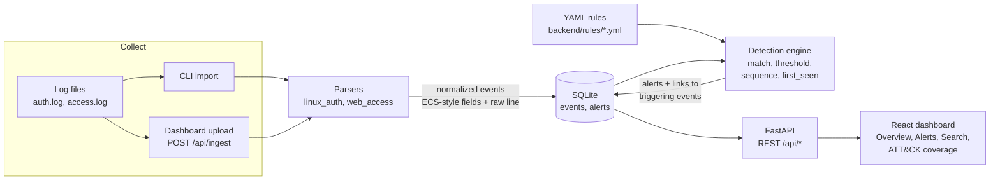
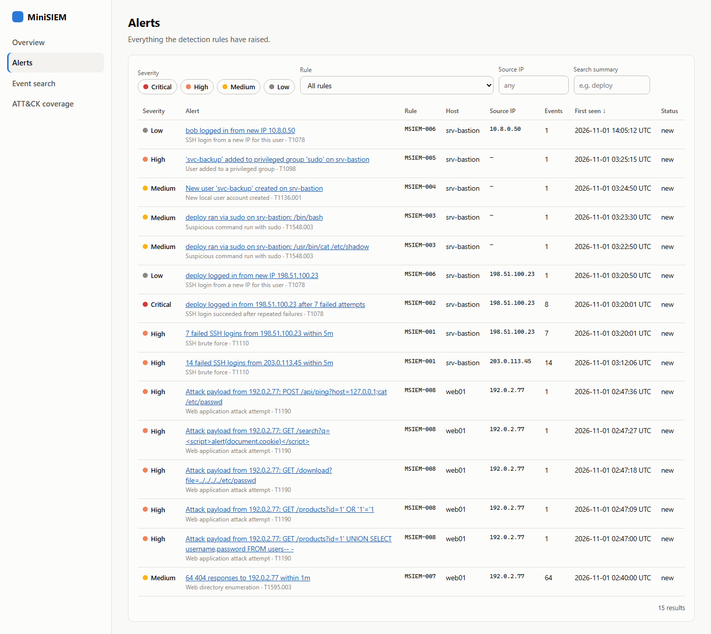
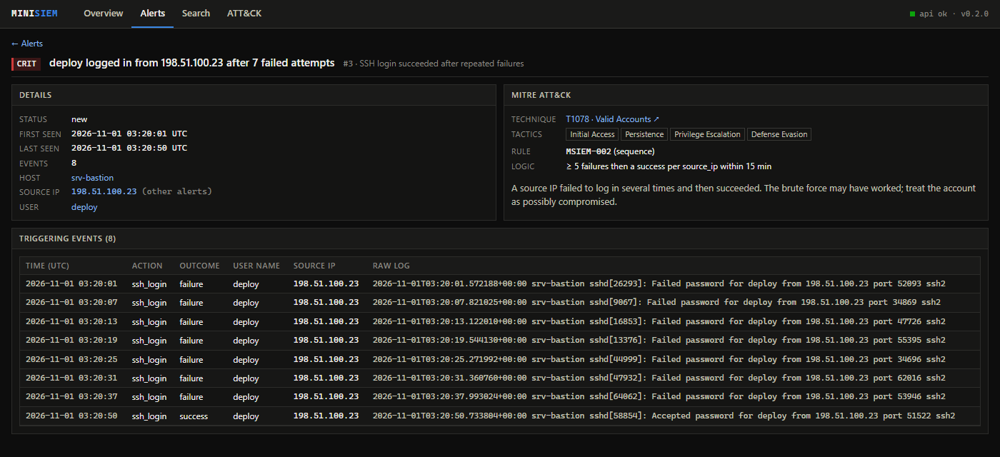
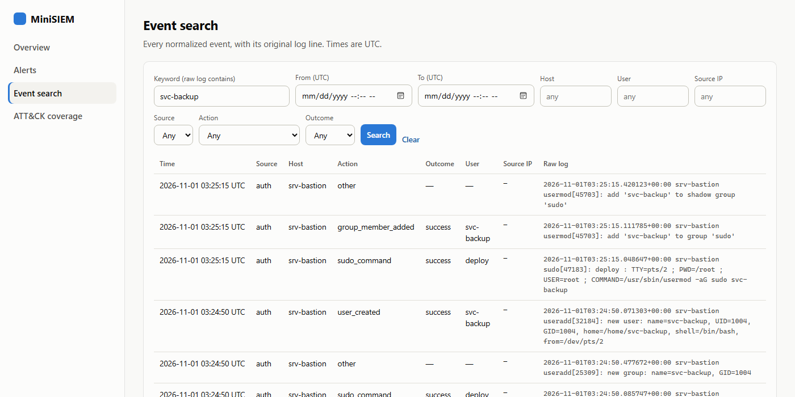
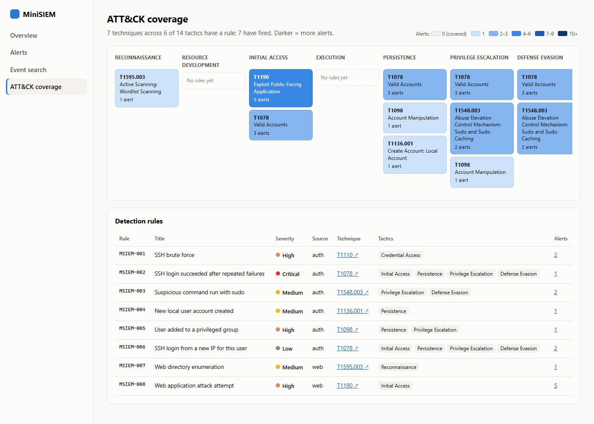

# MiniSIEM

A lightweight **Security Information and Event Management** tool. It ingests Linux auth logs and web server access logs, normalizes them into one event schema, runs **Sigma-style detection rules** mapped to **MITRE ATT&CK**, and shows the resulting alerts in a React dashboard. The bundled sample dataset replays a full intrusion, from web recon and SSH brute force to a successful login, privilege escalation and a backdoor account, so every rule fires in a repeatable demo.

**Live demo: <https://minisiem.vercel.app/>** (read-only, no password; the intrusion replays every hour).



## Quick start

Requires **Python 3.12+** and **Node 20.19+ or 22.12+**.

```bash
# 1. Backend: install, load the sample attack dataset, start the API on :8000
cd backend
python -m venv .venv
.venv/Scripts/activate            # Windows   (macOS/Linux: source .venv/bin/activate)
pip install -r requirements-dev.txt
python -m minisiem create-admin     # choose the dashboard password (saved to backend/.env)
python -m minisiem demo --serve

# 2. Frontend (second terminal, from the repo root): dashboard on :5173
npm install
npm run dev
```

Open <http://localhost:5173> and sign in as `admin` with the password you chose. API docs are at <http://localhost:8000/docs>.

`demo` resets the database, ingests `samples/auth.log` and `samples/access.log`, and runs detection:

```
Ingested   253 auth events from auth.log  (1 unparseable line(s) skipped)
Ingested   927 web events from access.log  (1 unparseable line(s) skipped)

Detection raised 15 alerts:
  MSIEM-001  SSH brute force                                   2
  MSIEM-002  SSH login succeeded after repeated failures       1
  ...
```

## Deploying to Vercel

The repo deploys to Vercel as one project. Vite builds the dashboard as static files, and `api/index.py` runs the FastAPI backend as a Python serverless function (`vercel.json` routes `/api/*` to it, and everything else to the single-page app).

**It runs as a self-contained, read-only demo.** Serverless functions can't keep files, so each function instance builds its own SQLite database in `/tmp` from [samples/examples/](samples/examples/) when it starts (about 2 seconds). The example dataset is shifted so that it ends at the present time (60 alerts). On top of that, the demo **replays the sample intrusion live** on host `demo-live`, from `samples/auth.log` and `samples/access.log`. The background lines keep their time of day and replay once a day, so events arrive around the clock. The attack itself (02:40–03:31 in the source day: the scan, the web attacks, both brute forces, the login, the sudo abuse and the backdoor account) replays every hour, starting on the hour, so a visitor at any time of day sees new alerts within the hour. Each line is inserted once its replay time has passed, and a cold start backfills the last 24 hours (about 4,100 events). Requests trigger the catch-up (throttled and locked, so it is cheap), and the dashboard polls every 15 seconds in demo mode.

**Visitors are guests.** In demo mode, anonymous visitors browse as a read-only `guest` with no password. `POST /api/detect` and `POST /api/ingest` return 403 for guests. The header shows "Demo · read-only" and a link to run the full version locally. An admin can still sign in to upload logs and re-run detection. Set `MINISIEM_GUEST=false` to turn guest mode off, which brings back the login-only behaviour.

Steps:

1. In Vercel, choose **Add New → Project**, import this repository and select the branch to deploy. Keep the detected defaults (framework Vite, `npm run build`, output `dist`).
2. Under **Project → Settings → General → Node.js Version**, choose **20.x (20.19 or newer) or 22.x (22.12 or newer)**. The Vite 8 build needs Node 20.19+ or 22.12+.
3. Optional, only if you want admin login on the hosted demo: generate the variables locally with
   ```bash
   cd backend && python -m minisiem create-admin --print
   ```
   and add `MINISIEM_ADMIN_USER`, `MINISIEM_ADMIN_PASSWORD_HASH` and `MINISIEM_SECRET_KEY` under **Project → Settings → Environment Variables**. Leave `MINISIEM_COOKIE_SECURE` unset, so cookies are HTTPS-only. Without these variables the guest view works as normal, but nobody can sign in as admin.
4. Click **Deploy** (or run `vercel --prod`). Open the URL: the dashboard should load without a password and show "Demo · read-only".

Demo-mode differences, set in `api/index.py` and overridable with environment variables: uploads are capped at 4 MB (Vercel's request limit), `X-Forwarded-For` is trusted for the client IP, and login rate limiting counts per instance. `vercel.json` also sets security headers on every response (see [Security](#security)).

## Architecture



| Component | Where | Notes |
|---|---|---|
| Collector | `backend/minisiem/ingest.py`, `POST /api/ingest` | Idempotent: re-ingesting a file adds nothing. Unparseable lines are counted and sampled, never silently dropped. |
| Parsers | `backend/minisiem/parsers/` | Classic and RFC 3339 syslog headers, sshd / sudo / PAM / useradd / usermod / gpasswd. Combined and Common Log Format. Timestamps normalized to UTC. |
| Storage | `backend/minisiem/db.py` | SQLite with indexes on time, IP, user and host. The original log line is always kept. |
| Detection | `backend/minisiem/detection/`, `backend/rules/` | Rules are data. Alerts are fingerprinted and upserted, so re-running detection never duplicates them. |
| API | `backend/minisiem/api.py` | Parameterized SQL everywhere, whitelisted sort columns, LIKE wildcards escaped. |
| Dashboard | `src/` | React 18 + Vite + React Router. Dense dark console theme with hand-drawn SVG charts. |

Design decisions and the full event schema are in [DECISIONS.md](DECISIONS.md).

## Log sources

| Source type | Files | Events extracted |
|---|---|---|
| `auth` | `/var/log/auth.log`, `/var/log/secure` | SSH logins (success/failure), invalid users, PAM auth failures, sessions, sudo commands, user creation, group membership changes |
| `web` | Apache / Nginx access logs | Every request: client IP, method, decoded URL, status, user agent |

## Detection rules

| ID | Rule | Type | Severity | ATT&CK |
|---|---|---|---|---|
| MSIEM-001 | SSH brute force (≥5 failures per IP in 5 min) | threshold | high | [T1110](https://attack.mitre.org/techniques/T1110/) Brute Force |
| MSIEM-002 | SSH login succeeded after ≥5 failures (15 min) | sequence | critical | [T1078](https://attack.mitre.org/techniques/T1078/) Valid Accounts |
| MSIEM-003 | Suspicious command via sudo (root shell, `/etc/shadow`, setuid, netcat…) | match | medium | [T1548.003](https://attack.mitre.org/techniques/T1548/003/) Sudo and Sudo Caching |
| MSIEM-004 | New local user account | match | medium | [T1136.001](https://attack.mitre.org/techniques/T1136/001/) Create Account: Local Account |
| MSIEM-005 | User added to sudo / wheel / admin / root / adm | match | high | [T1098](https://attack.mitre.org/techniques/T1098/) Account Manipulation |
| MSIEM-006 | SSH login from a new IP for that user | first_seen | low | [T1078](https://attack.mitre.org/techniques/T1078/) Valid Accounts |
| MSIEM-007 | Web directory enumeration (≥20 404s per IP in 1 min) | threshold | medium | [T1595.003](https://attack.mitre.org/techniques/T1595/003/) Wordlist Scanning |
| MSIEM-008 | Web attack payload (SQLi, traversal, XSS, command injection) | match | high | [T1190](https://attack.mitre.org/techniques/T1190/) Exploit Public-Facing Application |

Rules use a Sigma-like format. Thresholds, windows and patterns are all editable without touching Python:

```yaml
id: MSIEM-001
title: SSH brute force
severity: high
attack: { technique: T1110, name: Brute Force, tactics: [Credential Access] }
logsource: { source_type: auth }
detection:
  type: threshold
  selection:
    event_action: ssh_login
    event_outcome: failure
  group_by: [source_ip]
  threshold: 5
  timeframe: 5m
summary: "{count} failed SSH logins from {source_ip} within {timeframe}"
```

Selections support `field: value`, lists (any of), and the modifiers `|contains`, `|startswith`, `|endswith`, `|re`, `|gte` and `|lte`. Matching is case-insensitive.

## The demo scenario

`scripts/generate_attack.py` writes a deterministic day of logs (2026-11-01, UTC): normal admin logins, CI deploys, cron, web shoppers and internet SSH noise, plus this attack:

| Time | Actor | Activity | Rule(s) |
|---|---|---|---|
| 02:40 | 192.0.2.77 | gobuster wordlist scan of web01 | 007 |
| 02:47 | 192.0.2.77 | SQLi, path traversal, XSS, command injection | 008 ×5 |
| 03:12 | 203.0.113.45 | SSH brute force, fails | 001 |
| 03:20 | 198.51.100.23 | guesses `deploy`'s password and logs in | 001, 002, 006 |
| 03:22 | deploy | `sudo cat /etc/shadow`, `sudo /bin/bash` | 003 ×2 |
| 03:24 | deploy | creates `svc-backup` and adds it to `sudo` | 004, 005 |
| 14:05 | bob | logs in from the new VPN range (benign) | 006 |

Regenerate it with `python scripts/generate_attack.py`. A test checks that the sample data triggers every rule.

For more, [samples/examples/](samples/examples/) holds 29 single-scenario logs: benign baselines, each attack on its own, format edge cases (classic syslog, time-zone offsets, Common Log Format, corrupted lines) and evasions the current rules deliberately miss. Load them all with `python -m minisiem examples`.

## Using it

```bash
cd backend
python -m minisiem ingest /path/to/auth.log --source auth            # parse + detect
python -m minisiem ingest access.log --source web --host web01
python -m minisiem ingest old-auth.log --source auth --year 2025 --tz-offset -5
python -m minisiem detect      # re-run all rules
python -m minisiem rules       # list rules
python -m minisiem reset       # delete all events and alerts
python -m minisiem serve       # API only
```

You can also upload files from the **Overview** page (`.log` / `.txt`, max 10 MB locally, 4 MB on the Vercel demo).

### Authentication

Locally, the dashboard and every data endpoint require a login (in demo mode, anonymous visitors are read-only guests instead; see [Security](#security)). There is one admin account, configured through environment variables:

| Variable | Purpose |
|---|---|
| `MINISIEM_ADMIN_USER` | Username (default `admin`) |
| `MINISIEM_ADMIN_PASSWORD_HASH` | Salted PBKDF2-SHA256 hash (600k iterations). The plain password is never stored. |
| `MINISIEM_SECRET_KEY` | Signs session tokens. At least 32 random characters; changing it logs everyone out. |
| `MINISIEM_COOKIE_SECURE` | HTTPS-only cookie. On by default; `create-admin` turns it off in the local `.env` for plain-http development. |
| `MINISIEM_DEMO` | `true` turns on demo mode: guest mode by default, plus the live replay into the configured database (`MINISIEM_DB`) on every request. Seeding the demo database is done by the Vercel entry point (`api/index.py`), which also sets this flag. Locally, point `MINISIEM_DB` at a separate file before enabling it, or the replay writes `demo-live` events into your real database. |
| `MINISIEM_GUEST` | Read-only guest access for anonymous visitors. Defaults to on in demo mode and off everywhere else; `true` enables it outside demo mode, `false` turns it off even in demo mode. |
| `MINISIEM_TRUST_PROXY` | Read the client IP from `X-Forwarded-For`. Enable only behind a proxy you control (Vercel, Render, Fly). |

`python -m minisiem create-admin` writes these to `backend/.env` (git-ignored). `create-admin --print` prints them for a hosting provider's environment settings instead.

How it works:
- `POST /api/auth/login` checks the password in constant time and returns a signed JWT (HS256, 8-hour expiry) in an **httpOnly, SameSite=Strict, Secure** cookie. Page scripts can't read it, and other sites can't make the browser send it (CSRF).
- API clients can send the same token as `Authorization: Bearer <token>`.
- **Brute-force protection:** five failed logins from one IP lock it out for five minutes (HTTP 429). Wrong usernames and wrong passwords get the same message and take the same time, so valid usernames can't be discovered.
- **Fail closed:** without a password hash and a strong secret, the API refuses every request (503) instead of running open, unless guest mode is on (the demo default), in which case visitors get read-only guest access and only login returns 503.

```bash
curl -s -X POST localhost:8000/api/auth/login -H 'Content-Type: application/json'      -d '{"username":"admin","password":"..."}'          # -> {"token": "..."}
curl -s localhost:8000/api/alerts -H "Authorization: Bearer $TOKEN"
```

### API

All endpoints except `/api/health` and `/api/auth/login` require authentication (or guest access in demo mode, which is read-only).


| Method & path | Purpose |
|---|---|
| `GET /api/alerts` | Filter by `severity` (repeatable), `rule_id`, `host`, `source_ip`, `user_name`, `technique`, `start`, `end`, `q`; sort and paginate |
| `GET /api/alerts/{id}` | Alert, its rule, and its triggering events with raw lines |
| `GET /api/events` | Search by `source_type`, `host`, `user_name`, `source_ip`, `event_action`, `event_outcome`, time range, keyword |
| `GET /api/stats` | Counts by severity, events over time, top IPs, top targeted users |
| `GET /api/rules` | Rules with ATT&CK mapping and alert counts |
| `POST /api/ingest` | Multipart upload: `file`, `source_type`, optional `host`, `year`, `tz_offset` |
| `POST /api/detect` | Re-run detection |

## Security

MiniSIEM is a security tool, so its own attack surface matters. These are the measures in the code today.

**Authentication.** Passwords are stored only as salted PBKDF2-SHA256 hashes (600k iterations) and compared in constant time. A successful login sets an HS256 JWT in an httpOnly, SameSite=Strict cookie (Secure by default), so page scripts can't read it and other sites can't make the browser send it. Failed logins are rate-limited per IP (five failures, five-minute lockout, HTTP 429), and wrong usernames and wrong passwords look identical. The API fails closed: without a password hash and a strong secret key it returns 503 rather than running open, unless guest mode is on (the demo default), in which case visitors get read-only guest access. Forged, expired and `alg: none` tokens are rejected (tested).

**Guest mode (on by default in demo mode).** When `MINISIEM_DEMO=true` (the Vercel entry point sets it), anonymous visitors are a read-only `guest`. Guests can read alerts, events, stats and rules, but `POST /api/detect` and `POST /api/ingest` return 403. Admin login still works if the admin variables are set. `MINISIEM_GUEST=false` disables guest mode. Outside demo mode guests are off by default and every request needs a login; `MINISIEM_GUEST=true` enables them.

**Injection.** All SQL is parameterised. Sort columns and other identifiers come from allowlists, and LIKE wildcards in search terms are escaped. [backend/tests/test_injection.py](backend/tests/test_injection.py) sends SQL injection payloads through the filter, sort and pagination parameters. Out-of-range `start` and `end` values return 400.

**Upload validation.** Uploads are size-capped (10 MB locally, 4 MB on the demo) and checked before parsing: files containing NUL bytes or invalid UTF-8 are rejected with 415 (so Latin-1 files must be converted to UTF-8 first), and any line longer than 8192 characters gets 413. A UTF-8 BOM and CRLF line endings are accepted. See `backend/minisiem/uploads.py`.

**Security headers.** `vercel.json` sets these on every response: a Content Security Policy (`default-src 'self'`, no inline scripts, `frame-ancestors 'none'`, `base-uri 'self'`, `form-action 'self'`), `X-Content-Type-Options: nosniff`, `X-Frame-Options: DENY` and `Referrer-Policy: strict-origin-when-cross-origin`.

**Supply chain and CI.** [.github/workflows/ci.yml](.github/workflows/ci.yml) runs backend tests and `python -m minisiem rules`, the frontend build, `npm audit --audit-level=high`, `pip-audit` on both `backend/requirements.txt` and the root `requirements.txt` (the one Vercel installs), and a gitleaks secret scan. Dependabot proposes updates for pip, npm and GitHub Actions.

Known advisories: `npm audit` reports 2 moderate advisories in `react-router-dom` 6.x. The fix requires react-router v7, and this app is client-side only, so they are accepted for now. CI fails only on high severity.

**Secrets.** Secrets live only in environment variables or `backend/.env`, which is git-ignored. `backend/.env.example` holds placeholders only, and the git history was checked for real values.

**Threat model.** The public demo exposes a read-only view of synthetic data: the bundled sample logs and a replay of them, with made-up hosts and usernames. The attacker addresses in the generated intrusion (`samples/auth.log`, `samples/access.log`) come from the documentation-reserved ranges 192.0.2.0/24, 198.51.100.0/24 and 203.0.113.0/24, and its staff log in from private 10.x addresses. Background traffic (web visitors, internet SSH noise) and some attackers in the example scenarios use generated, public-looking addresses, so some of those belong to real networks; they appear only in fictional log lines. Guests can't write, no real logs exist on the server, the only credentials there are the optional admin password hash and signing key (if configured), and each serverless instance has its own throwaway database in `/tmp`. The worst case from abuse is load on a free-tier function, not exposure of real data. That is why letting anyone in without a password is acceptable here. A real deployment should set `MINISIEM_GUEST=false`, keep the admin login and serve the API over TLS. Not covered: a rate limit shared across instances, per-user accounts and audit logging.

## Screenshots

| Alerts | Alert detail |
|---|---|
|  |  |

| Event search | ATT&CK coverage |
|---|---|
|  |  |

## Tests

```bash
cd backend && python -m pytest
```

There are 285 tests: each parser (good, malformed and edge-case lines), each rule (should fire / should not fire), every example log against its manifest, ingestion idempotency, every API endpoint, input validation (upload checks, SQL injection payloads on every parameter, LIKE wildcards), the demo replay (including hourly attack alerts), guest mode and the Vercel entry point, and authentication (every endpoint rejects anonymous requests; forged, expired and `alg: none` tokens are rejected; rate limiting; failing closed).

## Tech stack

Python 3.12+ · FastAPI · SQLite · PyYAML · pytest · React 18 · Vite · React Router

## Limitations & future work

- Login rate limiting is kept in memory, per server process. With several instances (e.g. serverless), each counts separately, and a shared store such as Redis would make the limit global.
- Detection re-scans all stored events each run. That is fine for a demo dataset, but a production system would process incrementally.
- Ingestion is batch-only (CLI or upload). Real-time syslog or folder watching, alert triage (status, assignee, notes), cross-source correlation and Docker are in the M8 stretch list.
- Classic syslog lines have no year or time zone, so both are configurable at ingest time.

See [PROJECT_OUTLINE.md](PROJECT_OUTLINE.md) for the roadmap.
