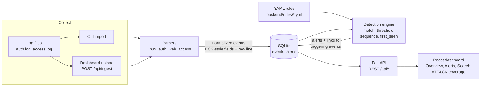

# MiniSIEM

A lightweight **Security Information and Event Management** tool. It ingests Linux auth logs and web server access logs, normalizes them into one event schema, runs **Sigma-style detection rules** mapped to **MITRE ATT&CK**, and shows the resulting alerts in a React dashboard. The bundled sample dataset replays a full intrusion, from web recon and SSH brute force to a successful login, privilege escalation and a backdoor account, so every rule fires in a repeatable demo.


## Quick start

Requires **Python 3.12+** and **Node 18+**.

```bash
# 1. Backend: install, load the sample attack dataset, start the API on :8000
cd backend
python -m venv .venv
.venv/Scripts/activate            # Windows   (macOS/Linux: source .venv/bin/activate)
pip install -r requirements-dev.txt
python -m minisiem demo --serve

# 2. Frontend (second terminal, from the repo root): dashboard on :5173
npm install
npm run dev
```

Open <http://localhost:5173>. API docs are at <http://localhost:8000/docs>.

`demo` resets the database, ingests `samples/auth.log` and `samples/access.log`, and runs detection:

```
Ingested   253 auth events from auth.log  (1 unparseable line(s) skipped)
Ingested   927 web events from access.log  (1 unparseable line(s) skipped)

Detection raised 15 alerts:
  MSIEM-001  SSH brute force                                   2
  MSIEM-002  SSH login succeeded after repeated failures       1
  ...
```

## Architecture



| Component | Where | Notes |
|---|---|---|
| Collector | `backend/minisiem/ingest.py`, `POST /api/ingest` | Idempotent: re-ingesting a file adds nothing. Unparseable lines are counted and sampled, never silently dropped. |
| Parsers | `backend/minisiem/parsers/` | Classic and RFC 3339 syslog headers, sshd / sudo / PAM / useradd / usermod / gpasswd. Combined and Common Log Format. Timestamps normalized to UTC. |
| Storage | `backend/minisiem/db.py` | SQLite with indexes on time, IP, user and host. The original log line is always kept. |
| Detection | `backend/minisiem/detection/`, `backend/rules/` | Rules are data. Alerts are fingerprinted and upserted, so re-running detection never duplicates them. |
| API | `backend/minisiem/api.py` | Parameterized SQL everywhere, whitelisted sort columns, LIKE wildcards escaped. |
| Dashboard | `src/` | React 18 + Vite + React Router, hand-drawn SVG charts, light and dark mode. |

Design decisions and the full event schema are in [DECISIONS.md](DECISIONS.md).

## Log sources

| Source type | Files | Events extracted |
|---|---|---|
| `auth` | `/var/log/auth.log`, `/var/log/secure` | SSH logins (success/failure), invalid users, PAM auth failures, sessions, sudo commands, user creation, group membership changes |
| `web` | Apache / Nginx access logs | Every request: client IP, method, decoded URL, status, user agent |

## Detection rules

| ID | Rule | Type | Severity | ATT&CK |
|---|---|---|---|---|
| MSIEM-001 | SSH brute force (≥5 failures per IP in 5 min) | threshold | high | [T1110](https://attack.mitre.org/techniques/T1110/) Brute Force |
| MSIEM-002 | SSH login succeeded after ≥5 failures (15 min) | sequence | critical | [T1078](https://attack.mitre.org/techniques/T1078/) Valid Accounts |
| MSIEM-003 | Suspicious command via sudo (root shell, `/etc/shadow`, setuid, netcat…) | match | medium | [T1548.003](https://attack.mitre.org/techniques/T1548/003/) Sudo and Sudo Caching |
| MSIEM-004 | New local user account | match | medium | [T1136.001](https://attack.mitre.org/techniques/T1136/001/) Create Account: Local Account |
| MSIEM-005 | User added to sudo / wheel / admin / root / adm | match | high | [T1098](https://attack.mitre.org/techniques/T1098/) Account Manipulation |
| MSIEM-006 | SSH login from a new IP for that user | first_seen | low | [T1078](https://attack.mitre.org/techniques/T1078/) Valid Accounts |
| MSIEM-007 | Web directory enumeration (≥20 404s per IP in 1 min) | threshold | medium | [T1595.003](https://attack.mitre.org/techniques/T1595/003/) Wordlist Scanning |
| MSIEM-008 | Web attack payload (SQLi, traversal, XSS, command injection) | match | high | [T1190](https://attack.mitre.org/techniques/T1190/) Exploit Public-Facing Application |

Rules use a Sigma-like format. Thresholds, windows and patterns are all editable without touching Python:

```yaml
id: MSIEM-001
title: SSH brute force
severity: high
attack: { technique: T1110, name: Brute Force, tactics: [Credential Access] }
logsource: { source_type: auth }
detection:
  type: threshold
  selection:
    event_action: ssh_login
    event_outcome: failure
  group_by: [source_ip]
  threshold: 5
  timeframe: 5m
summary: "{count} failed SSH logins from {source_ip} within {timeframe}"
```

Selections support `field: value`, lists (any of), and the modifiers `|contains`, `|startswith`, `|endswith`, `|re`, `|gte` and `|lte`. Matching is case-insensitive.

## The demo scenario

`scripts/generate_attack.py` writes a deterministic day of logs (2026-11-01, UTC): normal admin logins, CI deploys, cron, web shoppers and internet SSH noise, plus this attack:

| Time | Actor | Activity | Rule(s) |
|---|---|---|---|
| 02:40 | 192.0.2.77 | gobuster wordlist scan of web01 | 007 |
| 02:47 | 192.0.2.77 | SQLi, path traversal, XSS, command injection | 008 ×5 |
| 03:12 | 203.0.113.45 | SSH brute force, fails | 001 |
| 03:20 | 198.51.100.23 | guesses `deploy`'s password and logs in | 001, 002, 006 |
| 03:22 | deploy | `sudo cat /etc/shadow`, `sudo /bin/bash` | 003 ×2 |
| 03:24 | deploy | creates `svc-backup` and adds it to `sudo` | 004, 005 |
| 14:05 | bob | logs in from the new VPN range (benign) | 006 |

Regenerate it with `python scripts/generate_attack.py`. A test checks that the sample data triggers every rule.

## Using it

```bash
cd backend
python -m minisiem ingest /path/to/auth.log --source auth            # parse + detect
python -m minisiem ingest access.log --source web --host web01
python -m minisiem ingest old-auth.log --source auth --year 2025 --tz-offset -5
python -m minisiem detect      # re-run all rules
python -m minisiem rules       # list rules
python -m minisiem reset       # delete all events and alerts
python -m minisiem serve       # API only
```

You can also upload files from the **Overview** page (`.log` / `.txt`, max 10 MB).

### API

| Method & path | Purpose |
|---|---|
| `GET /api/alerts` | Filter by `severity` (repeatable), `rule_id`, `host`, `source_ip`, `user_name`, `technique`, `start`, `end`, `q`; sort and paginate |
| `GET /api/alerts/{id}` | Alert, its rule, and its triggering events with raw lines |
| `GET /api/events` | Search by `source_type`, `host`, `user_name`, `source_ip`, `event_action`, `event_outcome`, time range, keyword |
| `GET /api/stats` | Counts by severity, events over time, top IPs, top targeted users |
| `GET /api/rules` | Rules with ATT&CK mapping and alert counts |
| `POST /api/ingest` | Multipart upload: `file`, `source_type`, optional `host`, `year`, `tz_offset` |
| `POST /api/detect` | Re-run detection |

## Screenshots

| Alerts | Alert detail |
|---|---|
|  |  |

| Event search | ATT&CK coverage |
|---|---|
|  |  |

## Tests

```bash
cd backend && python -m pytest
```

There are 93 tests: each parser (good, malformed and edge-case lines), each rule (should fire / should not fire), ingestion idempotency, every API endpoint, and input validation (bad uploads, SQL injection in the sort parameter, LIKE wildcards).

## Tech stack

Python 3 · FastAPI · SQLite · PyYAML · pytest · React 18 · Vite · React Router

## Limitations & future work

- **No authentication yet.** Run it locally only. Auth on the API and dashboard is milestone M7.
- Detection re-scans all stored events each run. That is fine for a demo dataset, but a production system would process incrementally.
- Ingestion is batch-only (CLI or upload). Real-time syslog or folder watching, alert triage (status, assignee, notes), cross-source correlation and Docker are in the M8 stretch list.
- Classic syslog lines have no year or time zone, so both are configurable at ingest time.

See [PROJECT_OUTLINE.md](PROJECT_OUTLINE.md) for the roadmap.
